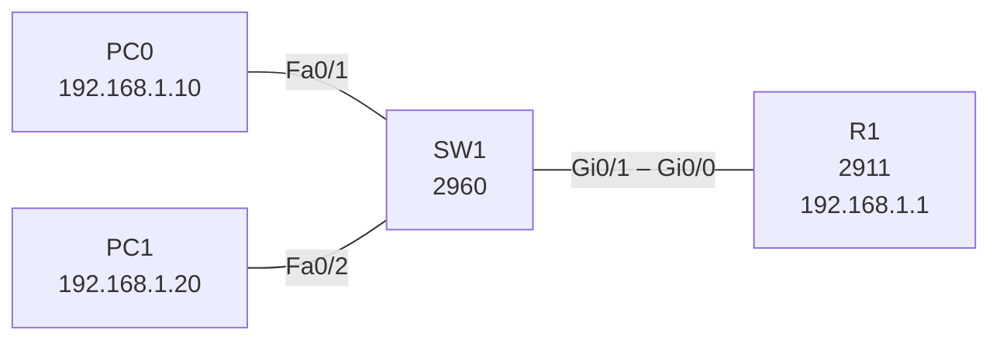

# Lab 01 – Basic router configuration

## Goal
Configure a router from scratch and connect two PCs in one LAN with the router as their default gateway.

## Topology



## Addressing

| Device | Interface | IP address | Default gateway |
|---|---|---|---|
| R1 | Gi0/0 | 192.168.1.1/24 | – |
| PC0 | NIC | 192.168.1.10/24 | 192.168.1.1 |
| PC1 | NIC | 192.168.1.20/24 | 192.168.1.1 |

## Key configuration (R1)

```
hostname R1
no ip domain-lookup
enable secret <REDACTED>
!
interface GigabitEthernet0/0
 ip address 192.168.1.1 255.255.255.0
 no shutdown
!
copy running-config startup-config
```

Full configs: [configs/](configs/)

## Verification

- `show ip interface brief` – Gi0/0 is `up/up` with 192.168.1.1
- `show startup-config` – configuration is saved to NVRAM
- PC0 → `ping 192.168.1.20` (PC1) and `ping 192.168.1.1` (gateway) – success
- SW1 → `show mac address-table` – PC MAC addresses learned on Fa0/1 and Fa0/2

## Key takeaways

- Router interfaces are `administratively down` by default – `no shutdown` is required.
- `running-config` lives in RAM; without `copy running-config startup-config` it is lost on reload.
- The switch works out of the box: all ports are in VLAN 1, so no switch config was needed here.
