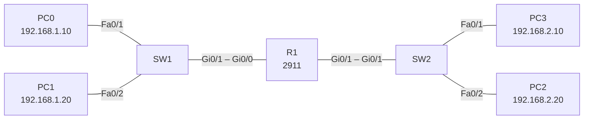

# Lab 02 – Routing between two networks

## Goal
Connect two separate IP networks through one router so hosts in different subnets can reach each other.

## Topology



## Addressing

| Device | Interface | IP address | Network | Default gateway |
|---|---|---|---|---|
| R1 | Gi0/0 | 192.168.1.1/24 | LAN 1 | – |
| R1 | Gi0/1 | 192.168.2.1/24 | LAN 2 | – |
| PC0 | NIC | 192.168.1.10/24 | LAN 1 | 192.168.1.1 |
| PC1 | NIC | 192.168.1.20/24 | LAN 1 | 192.168.1.1 |
| PC2 | NIC | 192.168.2.20/24 | LAN 2 | 192.168.2.1 |
| PC3 | NIC | 192.168.2.10/24 | LAN 2 | 192.168.2.1 |

## Key configuration (R1)

```
interface GigabitEthernet0/0
 ip address 192.168.1.1 255.255.255.0
 no shutdown
!
interface GigabitEthernet0/1
 ip address 192.168.2.1 255.255.255.0
 no shutdown
```

Full configs: [configs/](configs/)

## Verification

- `show ip route` – both 192.168.1.0/24 and 192.168.2.0/24 appear as directly connected (`C`)
- PC0 → `ping 192.168.2.10` – success across the router
- PC0 → `tracert 192.168.2.10` – first hop is 192.168.1.1

## Key takeaways

- A host only talks directly to its own subnet; everything else goes to the default gateway.
- Each router interface is a separate network – one interface, one subnet.
- Directly connected networks need no routing configuration – the router learns them automatically.
