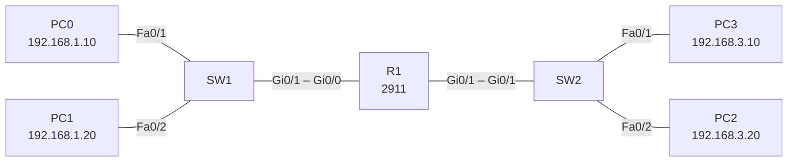

# Lab 03 – Troubleshooting

## Goal
Take the working two-network setup from [Lab 02](../02-two-networks/), break one thing at a time, and find the fault using only CLI commands before fixing it.

## Topology

Same as Lab 02. In the final state LAN 2 uses **192.168.3.0/24**.

| Device | Interface | IP address | Default gateway |
|---|---|---|---|
| R1 | Gi0/0 | 192.168.1.1/24 | – |
| R1 | Gi0/1 | 192.168.3.1/24 | – |
| PC0 / PC1 | NIC | 192.168.1.10 / .20 | 192.168.1.1 |
| PC2 / PC3 | NIC | 192.168.3.20 / .10 | 192.168.3.1 |

## Fault scenarios

| # | Fault introduced | Symptom | How I found it | Fix |
|---|---|---|---|---|
| 1 | `shutdown` on R1 Gi0/1 | LAN 2 unreachable from LAN 1 | `show ip interface brief` → `administratively down` | `no shutdown` |
| 2 | Wrong gateway on PC0 | PC0 reaches PC1, but not LAN 2 | `ipconfig` on PC0 | Set gateway to 192.168.1.1 |
| 3 | Wrong mask on PC2 (/16) | Partial, inconsistent connectivity | `ipconfig` on PC2 | Restore 255.255.255.0 |
| 4 | R1 Gi0/1 readdressed to another subnet | LAN 2 hosts have no valid gateway | `show ip interface brief`, `show running-config` | Re-address the network consistently (router + PCs) |
| 5 | Cable moved / removed | No link | `show ip interface brief`, `show mac address-table` | Reconnect to the correct port |
| 6 | `reload` without saving | Changes "disappear" | `show startup-config` | `copy running-config startup-config` |

## Troubleshooting method

1. **Physical / link** – `show ip interface brief` (is it `up/up`?)
2. **Addressing** – `ipconfig` on hosts, `show running-config` on the router
3. **Path** – `ping` the gateway first, then the remote host; `tracert` shows where traffic stops

Full configs: [configs/](configs/)

## Key takeaways

- Work bottom-up: check the link before the addressing, the gateway before the remote host.
- `administratively down` = shut down by config; `down/down` = no physical link.
- A wrong gateway breaks only traffic leaving the subnet – local pings still work, which is a useful clue.
