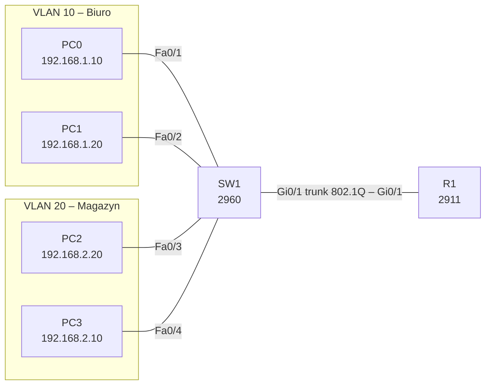

# Lab 04 – VLANs and inter-VLAN routing

## Goal
Split one switch into two VLANs (Biuro / Magazyn), prove they are isolated, then route between them with a router-on-a-stick over an 802.1Q trunk.

## Topology



## Addressing and VLANs

| Device | Interface | VLAN | IP address | Default gateway |
|---|---|---|---|---|
| R1 | Gi0/1.10 | 10 | 192.168.1.1/24 | – |
| R1 | Gi0/1.20 | 20 | 192.168.2.1/24 | – |
| PC0 | SW1 Fa0/1 | 10 | 192.168.1.10/24 | 192.168.1.1 |
| PC1 | SW1 Fa0/2 | 10 | 192.168.1.20/24 | 192.168.1.1 |
| PC2 | SW1 Fa0/3 | 20 | 192.168.2.20/24 | 192.168.2.1 |
| PC3 | SW1 Fa0/4 | 20 | 192.168.2.10/24 | 192.168.2.1 |

## Key configuration

**SW1**
```
vlan 10
 name Biuro
vlan 20
 name Magazyn
!
interface range FastEthernet0/1 - 2
 switchport mode access
 switchport access vlan 10
interface range FastEthernet0/3 - 4
 switchport mode access
 switchport access vlan 20
!
interface GigabitEthernet0/1
 switchport mode trunk
 switchport trunk allowed vlan 10,20
```

**R1**
```
interface GigabitEthernet0/1
 no shutdown
interface GigabitEthernet0/1.10
 encapsulation dot1Q 10
 ip address 192.168.1.1 255.255.255.0
interface GigabitEthernet0/1.20
 encapsulation dot1Q 20
 ip address 192.168.2.1 255.255.255.0
```

Full configs: [configs/](configs/)

## Verification

- `show vlan brief` – Fa0/1–2 in VLAN 10, Fa0/3–4 in VLAN 20
- `show interfaces trunk` – Gi0/1 status `trunking`, VLANs 10 and 20 in forwarding state
- Before the router: PC0 → PC1 works, PC0 → PC2 fails – the VLANs are isolated
- After router-on-a-stick: PC0 → `tracert 192.168.2.20` goes through 192.168.1.1

## Key takeaways

- A VLAN turns one physical switch into several separate broadcast domains.
- Access ports carry one VLAN untagged; a trunk carries many VLANs with 802.1Q tags.
- On the router the number in `encapsulation dot1Q` must match the VLAN ID – the subinterface number is only a label.
- Every port gets an explicit mode (`access` / `trunk`) instead of relying on DTP negotiation.
