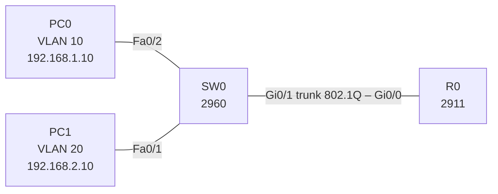

# Lab 05 – Router-on-a-stick (minimal build)

## Goal
Rebuild inter-VLAN routing from scratch on a minimal topology – one host per VLAN, one trunk to the router – to practise the configuration without notes.

## Topology



## Addressing

| Device | Interface | VLAN | IP address | Default gateway |
|---|---|---|---|---|
| R0 | Gi0/0.10 | 10 | 192.168.1.1/24 | – |
| R0 | Gi0/0.20 | 20 | 192.168.2.1/24 | – |
| PC0 | SW0 Fa0/2 | 10 | 192.168.1.10/24 | 192.168.1.1 |
| PC1 | SW0 Fa0/1 | 20 | 192.168.2.10/24 | 192.168.2.1 |

## Key configuration (R0)

```
interface GigabitEthernet0/0
 no shutdown
interface GigabitEthernet0/0.10
 encapsulation dot1Q 10
 ip address 192.168.1.1 255.255.255.0
interface GigabitEthernet0/0.20
 encapsulation dot1Q 20
 ip address 192.168.2.1 255.255.255.0
```

The switch side matches [Lab 04](../04-vlan/): access ports in VLAN 10 / 20 and a trunk on Gi0/1 allowing VLANs 10 and 20.

Full configs: [configs/](configs/)

## Verification

- `show ip interface brief` on R0 – Gi0/0, Gi0/0.10 and Gi0/0.20 are `up/up`
- `show interfaces trunk` on SW0 – Gi0/1 `trunking`
- PC0 → `ping 192.168.2.10` – success through the router

## Key takeaways

- The physical interface carries no IP address – it only needs `no shutdown`; the subinterfaces do the routing.
- One physical link replaces one router port per VLAN, which is how small branch networks are usually built.
