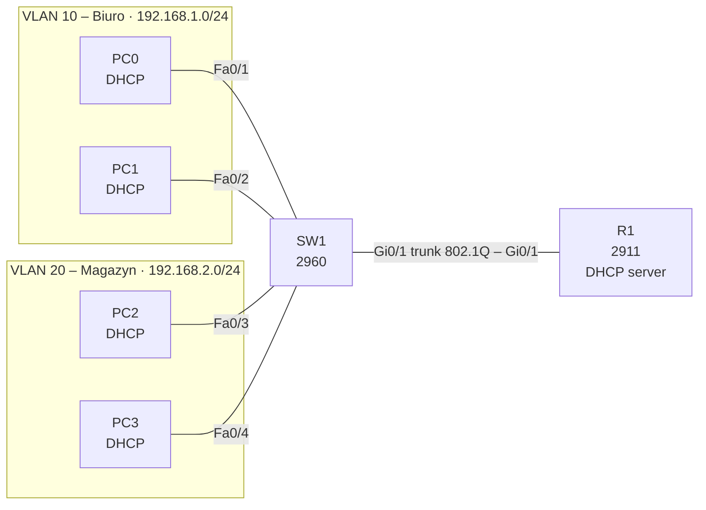

# Lab 06 – DHCP for multiple VLANs

## Goal
Replace static addressing from [Lab 04](../04-vlan/) with DHCP: the router hands out addresses, gateway and DNS to both VLANs from two separate pools.

## Topology



## DHCP design

| Pool | VLAN | Network | Excluded (static) | Handed out | Default gateway | DNS |
|---|---|---|---|---|---|---|
| VLAN10-BIURO | 10 | 192.168.1.0/24 | .1 – .10 | .11 – .254 | 192.168.1.1 | 8.8.8.8 |
| VLAN20-MAGAZYN | 20 | 192.168.2.0/24 | .1 – .10 | .11 – .254 | 192.168.2.1 | 8.8.8.8 |

The router knows which pool to use from the subinterface the request arrives on (Gi0/1.10 or Gi0/1.20).

## Key configuration (R1)

```
ip dhcp excluded-address 192.168.1.1 192.168.1.10
ip dhcp excluded-address 192.168.2.1 192.168.2.10
!
ip dhcp pool VLAN10-BIURO
 network 192.168.1.0 255.255.255.0
 default-router 192.168.1.1
 dns-server 8.8.8.8
!
ip dhcp pool VLAN20-MAGAZYN
 network 192.168.2.0 255.255.255.0
 default-router 192.168.2.1
 dns-server 8.8.8.8
```

VLANs, trunk and subinterfaces are unchanged from Lab 04. Full configs: [configs/](configs/)

## Verification

- PCs: *IP Configuration → DHCP* → "DHCP request successful"; `ipconfig /all` shows an address from .11 up, the correct gateway and DNS
- R1 `show ip dhcp binding` – one entry per PC (MAC → IP)
- R1 `show ip dhcp pool` – addresses leased per pool
- PC in VLAN 10 → `ping` PC in VLAN 20 – inter-VLAN routing still works
- Simulation mode, filter *DHCP*, `ipconfig /renew` – the four DORA messages (Discover, Offer, Request, Ack) travel over the trunk to R1

## Fault scenarios

| # | Fault introduced | Symptom | How to find it |
|---|---|---|---|
| 1 | Wrong `default-router` in the VLAN 10 pool | PCs get an address, but cannot leave their VLAN | `ipconfig` on the PC (wrong gateway), `show running-config \| section dhcp` |
| 2 | Current PC address added to `excluded-address` | After `clear ip dhcp binding *` and renew, the PC gets the next free address | `show ip dhcp binding` |
| 3 | `shutdown` on Gi0/1.20 | VLAN 20 PCs get APIPA `169.254.x.x` | `ipconfig`, `show ip interface brief` |
| 4 | `no service dhcp` | Pools exist, but nobody gets an address | `show running-config \| include dhcp` |

## Key takeaways

- One pool per VLAN – each VLAN is a separate subnet with its own gateway.
- `excluded-address` reserves space for statically addressed devices (router, printers, servers) and is set before the pools.
- `release` / `renew` normally returns the same address: the server remembers the MAC → IP binding.
- A `169.254.x.x` address on a client almost always means it never reached a DHCP server.
- Packet Tracer does not count down lease time; on real IOS the default lease is 1 day (`lease` command in the pool).
