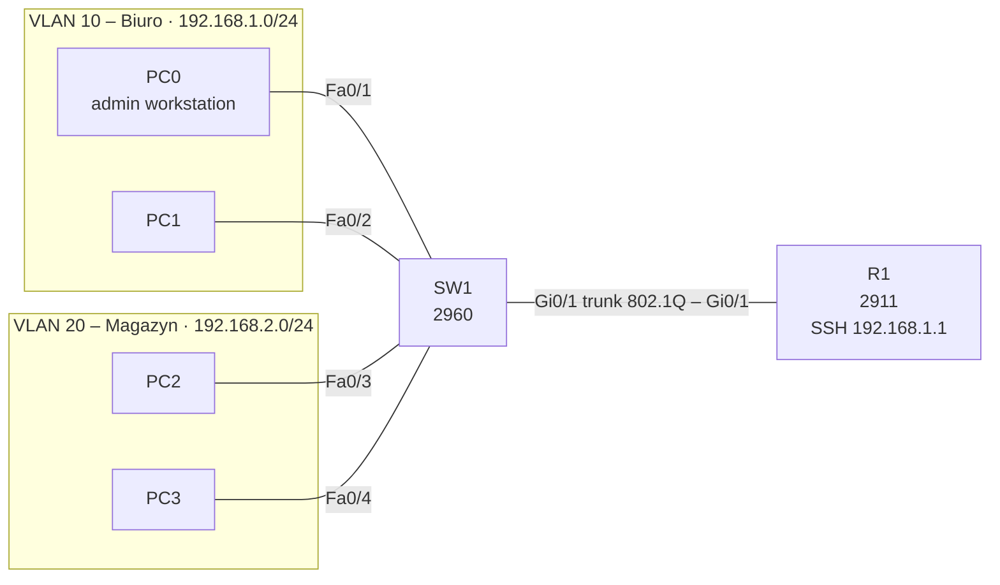

# Lab 07 – SSH and router hardening

## Goal
Manage R1 remotely over SSH instead of the console, block insecure Telnet, and add basic protection against unauthorised access and password guessing. Built on top of [Lab 06](../06-dhcp/).

## Topology



Addressing, VLANs and DHCP are unchanged from Lab 06. PC0 connects to R1 at 192.168.1.1 (its default gateway).

## Configuration, in three steps

**1. SSH access**
```
ip domain-name lab.local
crypto key generate rsa          ! modulus 2048
username admin secret <REDACTED>
!
line vty 0 4
 login local
 transport input ssh
```
A domain name is required to generate the RSA key pair; without the key SSH cannot start. `login local` checks the local user database, and `transport input ssh` allows SSH only.

**2. Privileged access and idle sessions**
```
enable secret <REDACTED>
line vty 0 4
 exec-timeout 5 0
```
Logging in gives only user mode (`R1>`); a second password is needed for `R1#`. Idle sessions close after 5 minutes.

**3. Password-guessing protection and warning banner**
```
login block-for 60 attempts 3 within 30
banner motd # Dostep tylko dla uprawnionych. #
service password-encryption
```
After 3 failed logins within 30 s, R1 refuses all logins for 60 s. `service password-encryption` hides any type-7 passwords in the running config.

Full configs (passwords redacted): [configs/](configs/)

## Verification

| Test (from PC0) | Expected | Result |
|---|---|---|
| `ssh -l admin 192.168.1.1` | Login prompt, then `R1>` | ✅ |
| `enable` in the SSH session | Asks for the enable secret, then `R1#` | ✅ |
| `telnet 192.168.1.1` | Connection refused – Telnet blocked | ✅ |
| 3 wrong passwords in a row | Next login refused, even with the correct password | ✅ |
| Wait 60 s, correct password | Login works again | ✅ |

On R1: `show login` shows the quiet-mode state and remaining block time; `show ssh` lists active sessions.

## Observations

- **The MOTD banner appears after the password over SSH**, not before. SSH authenticates during the encrypted handshake, before a terminal session exists; the banner is shown once the session opens. On console or Telnet it appears before login.
- **`login block-for` creates an ACL automatically.** The running config contains `ip access-list extended sl_def_acl` – the "quiet-mode" ACL IOS applies to the VTY lines while logins are blocked.

## Key takeaways

- Telnet sends credentials in clear text; SSH encrypts the whole session – production devices allow SSH only.
- Separate the login (`username ... secret`) from privileged access (`enable secret`).
- `secret` stores a hash; `password` + `service password-encryption` is only weak type-7 obfuscation.
- `login block-for` slows down brute-force attempts without any extra infrastructure.
