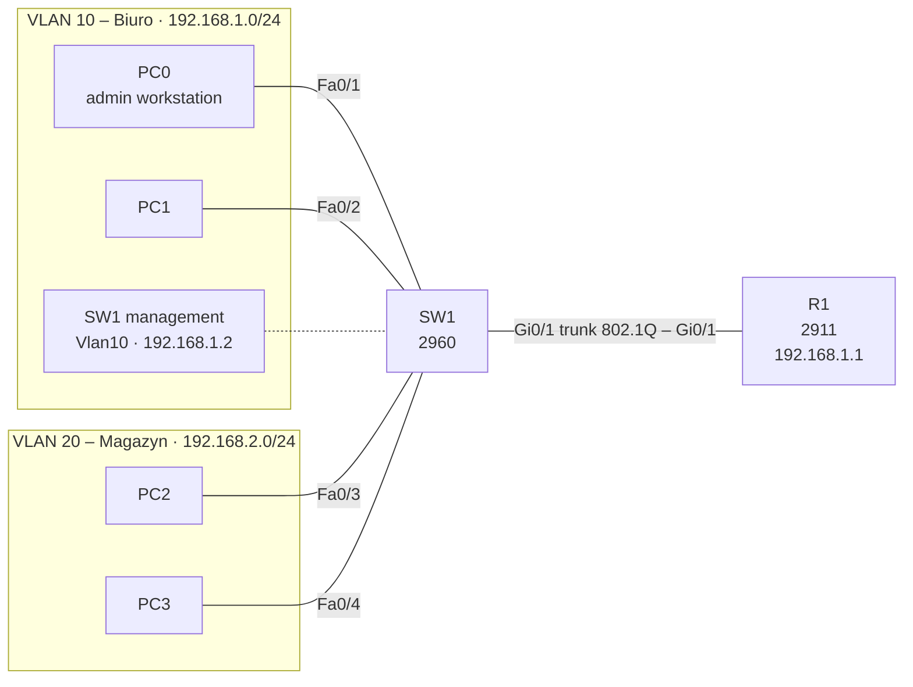

# Lab 08 – SSH management of a switch

## Goal
Give switch SW1 a management IP address and secure remote access over SSH, matching the hardening already applied to R1 in [Lab 07](../07-ssh/). This lab was done as a requirements-only task: the goal and checklist were given, the configuration was worked out independently.

## Requirements

| # | Requirement | Met |
|---|---|---|
| 1 | SW1 reachable at 192.168.1.2/24 in VLAN 10 | ✅ |
| 2 | SSH version 2 login as `admin` | ✅ |
| 3 | Telnet to SW1 refused | ✅ |
| 4 | Separate password for privileged mode | ✅ |
| 5 | Idle sessions closed after 5 minutes | ✅ |
| 6 | Console requires login | ✅ |
| 7 | Configuration survives a reload | ✅ |

## Topology



## Key configuration (SW1)

**Management address**
```
interface Vlan10
 ip address 192.168.1.2 255.255.255.0
 no shutdown
!
ip default-gateway 192.168.1.1
```
A Layer 2 switch has no IP addresses on its ports – it gets one on a VLAN interface (SVI). The default gateway lets the switch answer hosts in other subnets.

**SSH and access lines**
```
ip domain-name lab.local
crypto key generate rsa          ! modulus 2048
ip ssh version 2
username admin secret <REDACTED>
enable secret <REDACTED>
!
line console 0
 login local
line vty 0 15
 login local
 transport input ssh
 exec-timeout 5 0
```

Full configs (passwords redacted): [configs/](configs/)

## Verification

| Test | Expected |
|---|---|
| PC0 → `ping 192.168.1.2` | Replies from SW1 |
| PC0 → `ssh -l admin 192.168.1.2`, then `enable` | `SW1>` then `SW1#` after the enable secret |
| PC0 → `telnet 192.168.1.2` | Refused |
| SW1 → `show ip ssh` | SSH enabled, version 2.0 |
| SW1 → `show running-config \| section line` | Console and all VTY lines (0–4 and 5–15) secured |

## Mistakes made and fixed

| Mistake | Effect | Fix |
|---|---|---|
| `ip default-gateway 192.168.1.2` – the switch's own address | Switch cannot reply to hosts outside VLAN 10 | Gateway set to the router: 192.168.1.1 |
| `exec-timeout 300 0` | 300 **minutes** (5 h), not 5 min – syntax is `<minutes> <seconds>` | `exec-timeout 5 0` |
| `line 0 15` without `vty` | `%Error: Line 1 is not in async mode` – numbers read as absolute line numbers | `line vty 0 15` |

## Key takeaways

- A switch is managed through an SVI address plus `ip default-gateway`, not through its access ports.
- A 2960 has 16 VTY lines (0–15); securing only 0–4 leaves 11 lines open.
- Router VTY lines 5–15 are created by `line vty 0 15`; Packet Tracer does not support removing them (`no line vty 5 15`), so they must be secured the same way.
- Always name the line type: `line console 0`, `line vty 0 15`.
