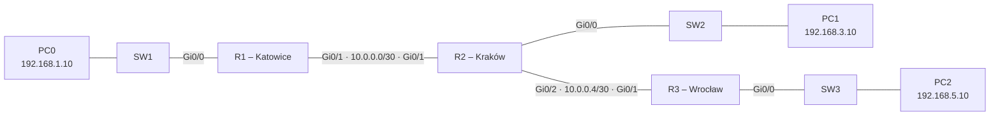

# Lab 09 – Static routing between three branches

## Goal
Connect three branch offices (Katowice, Kraków, Wrocław), each with its own router and LAN, using static routes only – and understand why every router needs a path both *to* and *back from* every network.

## Topology



## Addressing

| Network | Purpose | Addresses |
|---|---|---|
| 192.168.1.0/24 | Katowice LAN | R1 Gi0/0 .1 · PC0 .10 |
| 10.0.0.0/30 | Link R1–R2 | R1 .1 · R2 .2 |
| 192.168.3.0/24 | Kraków LAN | R2 Gi0/0 .1 · PC1 .10 |
| 10.0.0.4/30 | Link R2–R3 | R2 .5 · R3 .6 |
| 192.168.5.0/24 | Wrocław LAN | R3 Gi0/0 .1 · PC2 .10 |

Router-to-router links use /30 (255.255.255.252): exactly two usable addresses, one per router.

## Routing design

Each router needs a route to every network it is not directly connected to. Next hop is always the directly connected neighbour.

| Router | Directly connected (`C`) | Static routes (`S`) |
|---|---|---|
| R1 | 192.168.1.0/24, 10.0.0.0/30 | **default route** `0.0.0.0/0` via 10.0.0.2 |
| R2 | 192.168.3.0/24, 10.0.0.0/30, 10.0.0.4/30 | 192.168.1.0/24 via 10.0.0.1 · 192.168.5.0/24 via 10.0.0.6 |
| R3 | 192.168.5.0/24, 10.0.0.4/30 | 192.168.1.0/24, 192.168.3.0/24, 10.0.0.0/30 – all via 10.0.0.5 |

R1 and R3 are *stub* routers with a single neighbour. R1 uses one default route instead of three specific ones; R3 is kept with specific routes to show both approaches side by side.

```
! R1
ip route 0.0.0.0 0.0.0.0 10.0.0.2
! R2
ip route 192.168.1.0 255.255.255.0 10.0.0.1
ip route 192.168.5.0 255.255.255.0 10.0.0.6
! R3
ip route 192.168.1.0 255.255.255.0 10.0.0.5
ip route 192.168.3.0 255.255.255.0 10.0.0.5
ip route 10.0.0.0 255.255.255.252 10.0.0.5
```

Full configs (passwords redacted): [configs/](configs/)

## Verification

- `show ip route` – every router lists all five networks as `C` or `S`; R1 shows `Gateway of last resort is 10.0.0.2` and `S* 0.0.0.0/0`
- PC0 → `ping 192.168.5.10` and PC2 → `ping 192.168.1.10` – success in both directions
- PC2 → `ping 10.0.0.1` – reaches the far end of the R1–R2 link (needs R3's route to 10.0.0.0/30)
- PC0 → `tracert 192.168.5.10` – three hops: 192.168.1.1 → 10.0.0.2 → 10.0.0.6

## Observations

**A route on one side only is not enough.** With a route to Kraków on R1 but none back on R2, PC0 → PC1 fails: the request arrives, but R2 drops the reply because it has no route to 192.168.1.0. The reverse ping PC1 → PC0 fails too – this time already on the way *out*, at R2. Yet PC1 → 10.0.0.1 works, because every router on that particular path knows its part. Troubleshooting method: walk the packet hop by hop, both directions, and ask at each router *"do you know where to send this next?"*

**The mask must match the destination network.** `ip route 10.0.0.0 255.255.255.0 ...` (a /24) instead of /30 happened to work – the router picks the most specific match, so the directly connected 10.0.0.4/30 still won – but it would misroute any future 10.0.0.x link. Corrected to 255.255.255.252.

**A middle router cannot rely on a default route alone.** R2 has neighbours on both sides; a single default would send everything one way. It could combine a default route with one specific route (longest match wins) – the usual design where the default points to the internet and specific routes point to internal networks.

**Scaling limits.** Three routers and five networks already need several static routes on every router, and none of them adapt if a link fails. This is the problem dynamic routing (OSPF) solves.

## Key takeaways

- `ip route <network> <mask> <next hop>` – next hop is always a directly connected neighbour.
- Routing must work in both directions; most "it pings one way only" problems are a missing return route.
- The router always uses the most specific (longest-prefix) match; a default route `0.0.0.0/0` is used only when nothing else matches.
- `C` = connected, `L` = the router's own address (/32), `S` = static, `S*` = default route; `[1/0]` = administrative distance 1, metric 0.
- `tracert` sends three probes per hop; `*` means a probe got no reply.
