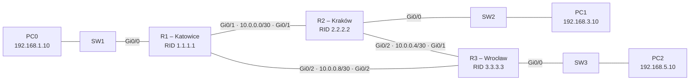

# Lab 10 – OSPF and automatic failover

## Goal
Replace the static routes from [Lab 09](../09-static-routing/) with single-area OSPF, then add a redundant link between Katowice and Wrocław and prove that traffic reroutes automatically when a link fails.

## Topology



## Addressing

| Network | Purpose | Addresses |
|---|---|---|
| 192.168.1.0/24 | Katowice LAN | R1 .1 · PC0 .10 |
| 192.168.3.0/24 | Kraków LAN | R2 .1 · PC1 .10 |
| 192.168.5.0/24 | Wrocław LAN | R3 .1 · PC2 .10 |
| 10.0.0.0/30 | Link R1–R2 | R1 .1 · R2 .2 |
| 10.0.0.4/30 | Link R2–R3 | R2 .5 · R3 .6 |
| 10.0.0.8/30 | Link R1–R3 (redundant path) | R1 .9 · R3 .10 |

## Configuration

Each router advertises only its directly connected networks; everything else is learned from neighbours. No static routes are configured.

```
! R1
router ospf 1
 router-id 1.1.1.1
 passive-interface GigabitEthernet0/0
 network 192.168.1.0 0.0.0.255 area 0
 network 10.0.0.0 0.0.0.3 area 0
 network 10.0.0.8 0.0.0.3 area 0
!
! R2
router ospf 1
 router-id 2.2.2.2
 passive-interface GigabitEthernet0/0
 network 192.168.3.0 0.0.0.255 area 0
 network 10.0.0.0 0.0.0.3 area 0
 network 10.0.0.4 0.0.0.3 area 0
!
! R3
router ospf 1
 router-id 3.3.3.3
 passive-interface GigabitEthernet0/0
 network 192.168.5.0 0.0.0.255 area 0
 network 10.0.0.4 0.0.0.3 area 0
 network 10.0.0.8 0.0.0.3 area 0
```

- `network <net> <wildcard> area 0` enables OSPF on matching interfaces **and** advertises those networks. A link network must be listed on both ends, in the same area, or the routers never become neighbours.
- `router-id` gives each router a stable, readable OSPF identity.
- `passive-interface` on the LAN port keeps advertising the LAN but stops sending OSPF hellos towards end users – less noise and no rogue neighbours from the office network.

Full configs (passwords redacted): [configs/](configs/)

## Verification

- `show ip ospf neighbor` – every router has two neighbours in state **FULL**
- `show ip route ospf` – remote networks appear as `O ... [110/cost] via ...`, learned without any static route
- PC0 ↔ PC1 ↔ PC2 – all pings succeed

## Failover test

Path from PC0 (Katowice) to PC2 (Wrocław), traced with `tracert 192.168.5.10`:

| State | Path | Hops (routers) | OSPF cost to 192.168.5.0/24 |
|---|---|---|---|
| All links up | R1 → R3 (direct link) | 2 | 2 |
| `shutdown` on R1 Gi0/2 | R1 → R2 → R3 | 3 | 3 |
| `no shutdown` on R1 Gi0/2 | R1 → R3 (direct link) | 2 | 2 |

When the direct link went down, R1 logged neighbour 3.3.3.3 going from FULL to DOWN, recalculated, and moved the route to 192.168.5.0/24 via 10.0.0.2 (R2). Pings kept working with no manual change. After the link came back, the adjacency returned to FULL and traffic switched back to the cheaper direct path.

Cost: each GigabitEthernet link has OSPF cost 1 (default reference bandwidth), so the direct path costs 1 + 1 = 2 and the path via Kraków 1 + 1 + 1 = 3. OSPF always installs the lowest total cost.

## Static vs OSPF – what changed since Lab 09

| | Static routing (Lab 09) | OSPF (this lab) |
|---|---|---|
| Routes typed by hand | 6+ across three routers | 0 |
| New branch added | edit every router | configure only the new router and its neighbours |
| Link failure | traffic is black-holed until an admin re-routes | rerouted automatically in seconds |
| Administrative distance | 1 | 110 |

## Key takeaways

- OSPF neighbours must agree on the link network and area; `show ip ospf neighbor` (state FULL) is the first thing to check.
- Routes learned via OSPF show as `O` with `[110/cost]`; the lowest total cost wins.
- Redundancy only helps if there is a second path – OSPF reroutes, it cannot create a link that does not exist.
- `passive-interface` on user-facing ports is standard practice.
